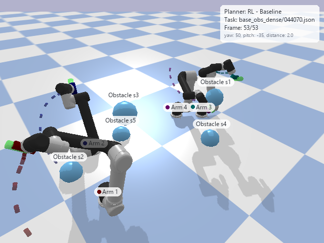

# Decentralized Multi-arm Motion Planning with Obstacle Avoidance

This repository extends the decentralized multi-arm motion planner of [Ha et al. (2020)](https://arxiv.org/abs/2011.02608) with obstacle avoidance. Every UR5 arm runs the same reinforcement learning (RL) policy on its own local observations, and the policy learns to reach its target pose while avoiding the other arms and the spherical obstacles in the workspace, which are either stationary or moving. A Dash webapp replays the planned trajectories as an animation and compares the RL planner against sampling-based planners from OMPL.



The code is built on the [source code of Ha et al.](https://github.com/huy-ha/decentralized-multiarm), and the base task data come from their [project page](https://multiarm.cs.columbia.edu/).

## Setup

The project uses three conda environments.

| Environment | File | Used for |
| --- | --- | --- |
| `multiarm` | `environment.yml` | task generation and training |
| `multiarm-ompl` | `environment_ompl.yml` | expert generation, evaluation and OMPL benchmarks |
| `multiarm-webapp` | `webapp/environment.yml` | the visualization webapp (Windows) |

```sh
conda env create -f environment.yml
conda env create -f environment_ompl.yml
conda env create -f webapp/environment.yml
```

OMPL has no Python bindings on Windows, so on Windows `multiarm-ompl` is created inside WSL instead.

## Default model

The `default/` folder holds the final planner, Baseline, and the configurations it was trained and evaluated with.

| File | Content |
| --- | --- |
| `default/Baseline` | checkpoint of the Baseline planner (`obstacle_v7_2`, checkpoint 610) |
| `default/train.json` | training configuration |
| `default/evaluate.json` | evaluation configuration |

## Task data

Training and evaluation start from the task data of Ha et al., which contain the base poses and targets of one to four arms but no obstacles. Download them into `tasks/`:

```sh
mkdir -p tasks/base
wget -qO- https://multiarm.cs.columbia.edu/downloads/data/tasks.tar.xz | tar xfJ - -C tasks/base/ --strip-components=1
```

Obstacles are then added to the base tasks, and tasks whose arms cannot reach their targets are filtered out with BiRRT. Movement is added to the obstacles of the evaluation tasks, and the expert demonstrations used in training are planned with BIT*. Each script takes `<source> <target> <workers>`, reads `tasks/<source>` and writes `tasks/<target>` (or `experts/<target>`). The scripts in `helper/` are run as modules from the repository root:

```sh
conda activate multiarm
python -m helper.obstacleGenerator base obstacle_v1 10
python -m helper.obstacleMotionGenerator obstacle_evaluate obstacle_evaluate_moving 10

conda activate multiarm-ompl
python -m helper.omplExpertGenerator obstacle_v1 obstacle_v1_bitstar 10
```

## Training

```sh
conda activate multiarm
python main.py --mode train --name baseline --config default/train.json \
    --tasks_path tasks/obstacle_v1 --expert_waypoints experts/obstacle_v1_bitstar/ \
    --num_processes 10
```

Checkpoints are saved to `runs/<name>/`. The configurations of the other trained versions are in `configs/`.

## Evaluation

Checkpoints and OMPL planners are benchmarked together by listing them in `configs/bulk_evaluate.json`, with `"config": "default/evaluate.json"` and checkpoints such as `"default/Baseline"`. The results are written to `benchmark/bulk/<timestamp>/`.

```sh
conda activate multiarm-ompl
python -m helper.bulk_evaluate configs/bulk_evaluate.json
```

## Webapp

The webapp runs on Windows in `multiarm-webapp`. OMPL and RL planning run in a separate worker process (`webapp/plan_worker.py`) in the `multiarm-ompl` environment inside WSL, which the webapp starts on its own. By default it looks for the interpreter at `/home/shenk/miniconda3/envs/multiarm-ompl/bin/python`; set `MULTIARM_WSL_PYTHON` (and `MULTIARM_WSL_DISTRO` if needed) to point elsewhere.

RL checkpoints are listed from `default/` and `runs/webapp/`, where the file name becomes the planner label, e.g. `default/Baseline` appears as `RL - Baseline`. Tasks are listed from the folders in `tasks/`. The planner order, the RL config and the playback settings are set in `webapp/config.json`.

From the repository root, run

```sh
conda activate multiarm-webapp
python -m webapp.app
```

and open <http://127.0.0.1:8050>.

## Citation

This project is based on the work and source code of Ha et al.:

```bibtex
@inproceedings{ha2020multiarm,
  title     = {Learning a Decentralized Multi-arm Motion Planner},
  author    = {Ha, Huy and Xu, Jingxi and Song, Shuran},
  booktitle = {Conference on Robot Learning (CoRL)},
  year      = {2020}
}
```
